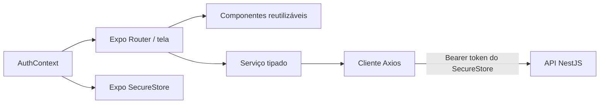

# Educa Blog Mobile

Aplicativo mobile do Educa Blog para leitura e gerenciamento de publicações e contas. O projeto usa Expo SDK 58, React Native, TypeScript e Expo Router, com uma API NestJS compartilhada pelo app.

## Sumário

- [Requisitos](#requisitos)
- [Setup inicial](#setup-inicial)
- [Comandos disponíveis](#comandos-disponíveis)
- [Arquitetura](#arquitetura)
- [Rotas e permissões](#rotas-e-permissões)
- [Integração com a API](#integração-com-a-api)
- [Guia de uso](#guia-de-uso)
- [Verificações](#verificações)
- [Referências](#referências)

## Requisitos

- Node.js compatível com Expo SDK 58;
- npm (o repositório mantém `package-lock.json`);
- Android Emulator, dispositivo Android com Expo Go compatível ou development build para executar no Android;
- Xcode e iOS Simulator para execução local no iOS;
- conexão com a internet para acessar a API.

O aplicativo usa Expo Router, SecureStore, Safe Area Context e módulos do Expo. Consulte a documentação versionada do SDK antes de atualizar Expo ou alterar integrações nativas. Este repositório não mantém diretórios `ios/` e `android/`; eles são gerados pelo fluxo Continuous Native Generation quando necessário.

## Setup inicial

Na raiz do repositório:

```bash
npm install
npx expo start
```

O Expo CLI exibirá um QR code e atalhos para abrir o app. Dependendo da plataforma e do SDK instalado no cliente Expo Go, poderá ser necessário usar um development build.

Para iniciar diretamente em um destino:

```bash
npx expo start --android
npx expo start --ios
npx expo start --web
```

No Android ou iOS físico, o computador e o dispositivo precisam conseguir se comunicar pela rede local. Se o bundler não for acessível pela rede, confira as opções de conexão do Expo CLI e as permissões de firewall.

### URL da API

A URL base está configurada em `src/services/api.ts`:

```text
https://post-api-7n8w.onrender.com/api/v1
```

Não há arquivo `.env` ou configuração de ambiente para essa URL atualmente. Para apontar o app para outro backend, altere a base URL no serviço Axios. Não altere contratos nem adicione parâmetros que não existam na API.

## Comandos disponíveis

| Comando | Descrição |
| --- | --- |
| `npm start` | Inicia o Expo CLI. |
| `npm run android` | Inicia o Expo CLI direcionado ao Android. |
| `npm run ios` | Inicia o Expo CLI direcionado ao iOS Simulator. |
| `npm run web` | Inicia a versão web. |
| `npm run lint` | Executa o ESLint via Expo. |
| `npx tsc --noEmit` | Verifica os tipos TypeScript sem gerar arquivos. |

Não há script de testes automatizados configurado neste momento.

## Arquitetura

As telas ficam em `src/app` e cada arquivo de tela define uma rota Expo Router. A lógica compartilhada vive fora dessa pasta: componentes reutilizáveis, serviços HTTP, contexto de autenticação, tipos e tema.

```text
src/
├── app/                   # Rotas e telas Expo Router
│   ├── _layout.tsx        # Provedor de sessão e proteção/redirecionamento de rotas
│   ├── posts/             # Listagem, detalhe, criação e edição de posts
│   ├── alunos/            # Listagem, criação, edição e exclusão de alunos
│   ├── usuarios/          # Gerenciamento geral de usuários para professores
│   ├── perfil.tsx         # Edição dos dados da conta autenticada
│   ├── login.tsx
│   ├── register.tsx
│   └── meus-posts.tsx     # Publicações do professor autenticado
├── components/
│   ├── common/            # Cabeçalho e ações fixas de rodapé
│   ├── posts/             # Cards, formulários e listagem compartilhada de posts
│   ├── users/             # Card e formulário compartilhados de usuário
│   └── auth/              # Layout das telas de autenticação
├── contexts/
│   └── AuthContext.tsx    # Sessão, login, logout e atualização do perfil local
├── services/              # Axios e chamadas para posts, usuários e disciplinas
├── theme/                 # Cores, espaçamentos, tipografia e bordas
├── types/                 # Contratos TypeScript da API e dos modelos da interface
└── hooks/                 # Hooks auxiliares, como tema e esquema de cores
```

### Fluxo de dados



### Navegação e proteção

- `src/app/_layout.tsx` envolve as telas com `AuthProvider` e redireciona visitantes sem sessão para `/login`.
- O token e o usuário autenticado são recuperados do Expo SecureStore ao iniciar o app.
- O roteador aplica restrições de navegação conforme os papéis `ALUNO` e `PROFESSOR`.
- `AppHeader` oferece o menu de navegação; o título “Educa Blog” abre a listagem de posts.
- `BottomActionBar` é reutilizado para ações de voltar ou cancelar posicionadas no rodapé.

Essas verificações no aplicativo controlam a experiência e a navegação. A API também precisa validar autorização para cada operação; uma rota escondida ou bloqueada no cliente não substitui autorização no servidor.


### Serviços e tipos

- `services/api.ts`: cliente Axios, URL base, timeout e interceptor `Authorization: Bearer` lendo `accessToken` do SecureStore.
- `services/auth.service.ts`: login, logout, cadastro inicial e persistência da sessão.
- `services/post.service.ts`: listagem, busca, detalhe, posts do professor, criação, atualização e exclusão.
- `services/user.service.ts`: operações de usuários, listagem paginada e busca. `getAllUsers` percorre as páginas da API para montar a lista completa usada na área de alunos e nos filtros de perfil do professor.
- `services/discipline.service.ts`: carrega disciplinas para o formulário de posts.
- `types/api.ts`: resposta paginada comum `PaginatedResponse<T>`.
- `types/post.ts`, `types/user.ts` e `types/auth.ts`: modelos e payloads usados pelos serviços e telas.

O endpoint `GET /users` aplica o escopo de perfis conforme o usuário autenticado: para `ALUNO`, retorna apenas usuários com perfil `ALUNO`; para `PROFESSOR`, retorna alunos e professores. Na tela `/usuarios`, a opção **Todos** usa a paginação da API. O professor também pode selecionar **Alunos** ou **Professores**; nesses casos, o app carrega as páginas da busca e aplica o filtro escolhido antes de paginar a lista. A busca por nome/e-mail usa o parâmetro `search`.

## Rotas e permissões

Todas as rotas de conteúdo exigem sessão, exceto `/login` e `/register`.

| Rota | Uso | Acesso na interface |
| --- | --- | --- |
| `/` | Alias da listagem de posts. | Aluno e professor |
| `/posts` | Listagem e busca de publicações. | Aluno e professor |
| `/posts/[id]` | Detalhe de uma publicação. | Aluno e professor |
| `/meus-posts` | Lista e gerencia publicações próprias. | Professor |
| `/posts/novo` | Cria publicação; o atalho é oferecido na área do professor. | Professor pela interface |
| `/posts/[id]/editar` | Edita publicação; o atalho é oferecido na área do professor. | Professor pela interface |
| `/perfil` | Consulta e edita os dados da conta autenticada. | Aluno e professor |
| `/usuarios` | Lista os perfis retornados pela API e permite cadastro, edição e exclusão. | Professor |
| `/alunos` | Lista somente usuários com `role: ALUNO`. | Aluno |
| `/alunos/novo` | Cadastra uma conta com perfil fixo `ALUNO`. | Aluno |
| `/alunos/[id]/editar` | Edita um cadastro de aluno. | Aluno; a tela valida o perfil carregado |
| `/login` | Inicia sessão. | Público |
| `/register` | Cria uma conta e permite selecionar Aluno ou Professor. | Público |

Na área `/alunos`, o aluno pode cadastrar, editar e excluir outros alunos. O próprio cadastro não tem ação de exclusão na listagem. A edição da própria conta também está disponível em **Meu perfil**.

## Integração com a API

Base URL atual:

```text
https://post-api-7n8w.onrender.com/api/v1
```

### Endpoints utilizados

| Método | Endpoint | Uso no app |
| --- | --- | --- |
| `POST` | `/auth/login` | Autenticação e recebimento do token. |
| `POST` | `/users` | Cadastro inicial e criação de contas. |
| `GET` | `/users?page=&limit=&search=` | Listagem paginada e busca por nome/e-mail; os perfis retornados dependem do papel autenticado. |
| `GET` | `/users/:id` | Carregamento de perfil ou usuário para edição. |
| `PUT` | `/users/:id` | Atualização de nome, e-mail e, opcionalmente, senha. |
| `DELETE` | `/users/:id` | Exclusão de conta pelas telas de gerenciamento. |
| `GET` | `/posts?page=&limit=` | Listagem paginada de posts. |
| `GET` | `/posts/search?search=&page=&limit=` | Busca de publicações. |
| `GET` | `/posts/me?page=&limit=` | Posts do professor autenticado. |
| `GET` | `/posts/:id` | Detalhe de post. |
| `POST` | `/posts` | Criação de post. |
| `PUT` | `/posts/:id` | Atualização de post. |
| `DELETE` | `/posts/:id` | Exclusão de post. |
| `GET` | `/discipline` | Opções de disciplina no formulário de post. |

### Paginação e payloads de usuário

As respostas paginadas seguem `PaginatedResponse<T>`:

```json
{
  "total": 25,
  "page": 1,
  "limit": 10,
  "totalPages": 3,
  "data": []
}
```

Os papéis válidos são `ALUNO` e `PROFESSOR`. A criação exige `name`, `email`, `password` e `role`. A atualização aceita `name`, `email` e `password` opcionais; o perfil não pode ser alterado. A interface nunca exibe senha retornada pela API. Nas edições, o campo de nova senha começa vazio, mostra uma máscara como placeholder e só envia `password` quando um novo valor foi digitado.

O app trata conflitos de e-mail (`HTTP 409`) nas telas de criação e atualização. As demais falhas apresentam mensagens para tentar novamente.

## Guia de uso

### Acessar o app

1. Abra o app e selecione **Criar cadastro** ou entre com e-mail e senha.
2. No cadastro inicial, escolha `Aluno` ou `Professor`.
3. Depois de autenticado, abra o menu pelo botão no cabeçalho. Toque em **Educa Blog** para voltar à listagem de posts.

### Aluno

- **Início** abre `/posts`, onde é possível buscar, paginar e ler publicações.
- **Meu perfil** permite alterar nome, e-mail e, se desejado, senha.
- **Usuários** abre a área `/alunos`, limitada aos cadastros `ALUNO`.
- **Novo** cadastra outro aluno. O perfil é fixado como `ALUNO`.
- Cada cartão permite editar o aluno. A exclusão de outro aluno exige confirmação; o próprio cadastro não oferece botão de excluir.

### Professor

- **Meus posts** lista as publicações próprias, com ações de visualizar, editar, excluir e criar.
- **Usuários** oferece listagem de alunos e professores, busca, filtros por perfil, paginação, criação, edição e exclusão. A opção **Todos** segue a paginação e o escopo da API.
- **Meu perfil** edita os dados da conta de professor.
- A listagem pública de posts pode ser aberta em **Início**.

### Formulários

- Campos obrigatórios são validados antes do envio.
- A seleção de disciplina no formulário de post é carregada pela API.
- Em edição de usuário, a senha permanece vazia; deixe sem preencher para manter a senha atual.
- **Cancelar** e **Voltar para posts** ficam fixos na barra inferior das telas correspondentes.

## Verificações

Antes de enviar alterações, rode:

```bash
npx tsc --noEmit
npx expo lint
```

O projeto atualmente não tem uma suíte de testes automatizados ou comando `test` no `package.json`.

## Referências

- [Expo SDK 58](https://docs.expo.dev/versions/v58.0.0/)
- [Expo Router — documentação do SDK 58](https://docs.expo.dev/versions/v58.0.0/sdk/router.md)
- [Configuração de ESLint no Expo](https://docs.expo.dev/guides/using-eslint/)
- [TypeScript com Expo](https://docs.expo.dev/guides/typescript/)
- [Documentação da API](https://post-api-7n8w.onrender.com/docs)
